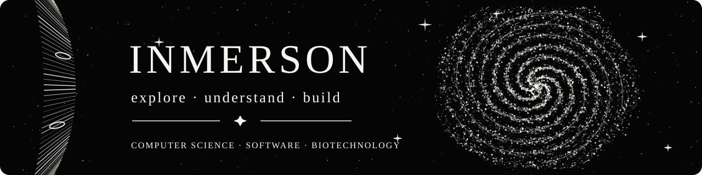

## Halil İbrahim Öztürk

**Computer Science student building software, learning systems, and scientific tools.**

I work on structured digital environments for computer science, biotechnology, mathematics, and AI-assisted learning.

**[Inmersion-CS](https://github.com/Inmersion-CS)** · **[Inmersion-Biotech](https://github.com/Inmersion-Biotech)**

[Repositories](https://github.com/Inmerson?tab=repositories) · [Stars](https://github.com/Inmerson?tab=stars) · [Projects](https://github.com/Inmerson?tab=projects)

---

## Orbit

I build projects around three connected areas:

- **Software engineering**
- **Interactive learning systems**
- **Scientific and mathematical exploration**

My work focuses on clarity, structure, careful observation, and practical tools that make difficult subjects more understandable.

## Constellations

| Space | Focus |
| --- | --- |
| **[Inmersion-CS](https://github.com/Inmersion-CS)** | Computer science learning tools, programming, systems, mathematics, and university-focused software |
| **[Inmersion-Biotech](https://github.com/Inmersion-Biotech)** | Biotechnology-oriented software, scientific visualization, quantitative learning, and interactive study tools |

## Selected Work

| Project | Description | Stack | Links |
| --- | --- | --- | --- |
| **[Math-CS](https://github.com/Inmerson/Math-CS)** | Interactive mathematics workspace for core computer science mathematics topics. | React · TypeScript · Vite | [Repo](https://github.com/Inmerson/Math-CS) |
| **[Math & Biotech Lab](https://github.com/Inmersion-Biotech/Math-Biotech-Project)** | Mathematics and biotechnology learning lab with calculations, visualization, and PWA support. | React · TypeScript · Three.js · Capacitor | [Repo](https://github.com/Inmersion-Biotech/Math-Biotech-Project) · [Live](https://inmersion-biotech.github.io/Math-Biotech-Project/) |
| **[InfoSystems](https://github.com/Inmersion-CS/InfoSystems)** | Learning project for requirements, process modeling, data modeling, and systems thinking. | React · TypeScript · Vite | [Repo](https://github.com/Inmersion-CS/InfoSystems) · [Live](https://inmersion-cs.github.io/InfoSystems/) |
| **[Safety](https://github.com/Inmersion-CS/Safety)** | Interactive learning project for occupational safety, ergonomics, and risk awareness. | React · TypeScript · Vite | [Repo](https://github.com/Inmersion-CS/Safety) · [Live](https://inmersion-cs.github.io/Safety/) |
| **[Chat On Steroids](https://github.com/Inmerson/chat-on-steroids)** | Local desktop bridge for ChatGPT workflows over MCP. Public fork with active work and clear upstream attribution. | TypeScript · Electron | [Repo](https://github.com/Inmerson/chat-on-steroids) |

## Current Trajectory

- Building interactive learning environments for technical subjects
- Exploring AI-assisted study workflows with clear boundaries
- Connecting mathematics, software, and scientific visualization
- Growing **Inmersion-CS** and **Inmersion-Biotech** as focused project ecosystems

## Tech Stack

`TypeScript` · `React` · `Vite` · `Vitest` · `Node.js` · `Tailwind CSS` · `Three.js` · `Capacitor` · `GitHub Actions`

## Transmission Links

[GitHub](https://github.com/Inmerson) · [Inmersion-CS](https://github.com/Inmersion-CS) · [Inmersion-Biotech](https://github.com/Inmersion-Biotech)

---

**Exploring systems, one structured layer at a time.**

